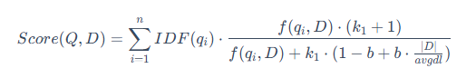
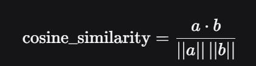

RAG 的基础是 embedding 嵌入，embedding 是文本向量化技术，embedding 在 NLP 相关知识那一章有提及，这项技术是将文本转换为向量表示，然后通过计算向量之间的相似度来找到最相关的文档。向量数据库是 RAG 的核心组件，它存储了所有文档的向量表示，以及这些向量之间的相似度。核心查询方式是**相似性搜索**

## 向量数据库选型

我们可以选择一些托管服务。这类适合那些不希望花精力在运维上，追求快速上线的团队

- Zilliz Cloud：它基于全球热门的开源数据库 Milvus 打造，自带高性能和数十亿向量处理能力，并通过公有云提供服务。非常适合那些希望拥有 Milvus 强大性能，但不想自己搭建和运维复杂集群的团队。
- 腾讯云 VectorDB：这款云原生数据库集成了 AI 套件，支持像 Markdown、PDF 等文档的自动解析、向量化和检索，大大降低了入门门槛。在 VectorDBBench 性能榜单上表现亮眼，成本据称仅为同类产品的1/3。非常适合初创团队和需要快速构建知识库的中小企业。
- MongoDB Atlas Vector Search：在开发者调查中，它的净推荐值（NPS）是最高的，非常受欢迎。优势在于能将文档数据库和向量搜索无缝结合，非常适合那些已经深度使用 MongoDB 的团队，可以复用现有生态。

同时还可以选择一些开源数据库，这类适合有一定运维能力，希望深度掌控技术栈的团队。

- Milvus（Zilliz）：全球最流行的开源向量数据库，在 GitHub 上有超过35,000颗星。它核心优势在于分布式架构并且生态完整，提供 Python/Java/Go 等多种语言的 SDK，能与 Spark、Flink 等大数据生态深度集成，也支持 LangChain 等 AI 框架。
- Qdrant：一个用高性能语言 Rust 写成的数据库，性能很突出。它的优势在于高性能并且功能丰富

当然下面这些优秀的工程也可以解决我们的问题：

- PgVector：对于已经在使用 PostgreSQL 的团队来说，这是个很“顺手”的选择。它是一个扩展插件，让你能在熟悉的 PostgreSQL 环境中同时处理关系数据和向量数据，用 SQL 进行混合查询。优势是复用现有数据库，无需引入新组件，但缺点也很明显：在向量搜索性能上不如专用的数据库，索引构建也较慢。同样适合百万级以下规模
- Elasticsearch：在原有的全文搜索强项基础上增加了向量搜索功能，统一了全文检索和向量检索。适合已经深度使用 ES，希望升级到“语义+关键词”混合搜索的场景
- FAISS：严格意义上说，它是一个高效的相似性搜索库而非完整的数据库，由 Facebook 开源。它提供了多种先进的索引算法，性能卓越，适合个人本地项目练手


## 稀疏向量和密集向量
混合检索（Hybrid Search）是一种结合了稀疏向量（Sparse Vectors） 和密集向量（Dense Vectors） 优势的先进搜索技术。旨在同时利用稀疏向量的关键词精确匹配能力和密集向量的语义理解能力，以克服单一向量检索的局限性，从而在各种搜索场景下提供更准确的检索结果

1，稀疏向量，也常被称为词法向量，是基于词频统计的传统信息检索方法的数学表示。它通常是一个维度极高（与词汇表大小相当）但绝大多数元素为零的向量。它采用精准的词袋匹配模型，将文档视为一堆词的集合，不考虑其顺序和语法，其中向量的每一个维度都直接对应一个具体的词，非零值则代表该词在文档中的重要性（权重）。这类向量的经典权重计算方法是 TF-IDF。在信息检索领域，BM25 则是基于这种稀疏表示的成功且应用广泛的排序算法之一，其核心公式如下：

这种方法的优点是可解释性极强（每个维度都代表一个确切的词），无需训练，能够实现关键词的精确匹配，对于专业术语和特定名词的检索效果好。主要缺点是无法理解语义，例如它无法识别“汽车”和“轿车”是同义词，存在“词汇鸿沟”

2，密集向量，也常被称为语义向量，是通过深度学习模型学习到的数据（如文本、图像）的低维、稠密的浮点数表示。这些向量旨在将原始数据映射到一个连续的、充满意义的语义空间中来捕捉语义或概念。在理想的语义空间中，向量之间的距离和方向代表了它们所表示概念之间的关系。一个经典的例子是 vector('国王') - vector('男人') + vector('女人') 的计算结果在向量空间中非常接近 vector('女王')，这表明模型学会了“性别”和“皇室”这两个维度的抽象概念。它的代表包括 Word2Vec、GloVe、以及所有基于 Transformer 的模型（如 BERT、GPT）生成的嵌入（Embeddings）

其主要优点是能够理解同义词、近义词和上下文关系，泛化能力强，在语义搜索任务中表现卓越。但缺点也同样明显：可解释性差（向量中的每个维度通常没有具体的物理意义），需要大量数据和算力进行模型训练，且对于未登录词（OOV）1的处理相对困难

**OOV**（Out-of-Vocabulary）未登录词指在模型训练时没有出现在词汇表中，但在实际使用时遇到的新词汇。例如，如果模型训练时词汇表中没有 ChatGPT 这个词，那么在实际应用中遇到它时就是 OOV。传统的稀疏向量方法（如 BM25）对 OOV 词汇会完全忽略，而现代的密集向量方法通过子词分割（如 BPE、WordPiece）可以更好地处理 OOV 问题

## 向量搜索算法
### 余弦相似度
余弦相似度是一种常用的向量相似度计算方法，它将向量表示为单位向量，然后计算它们之间的夹角余弦值。余弦相似度的取值范围是 -1 到 1，1 表示两个向量完全相同，-1 表示完全相反。两个向量 a 和 b 的余弦相似度定义为：



就是初中学的 cosine 相似度，||a|| 表示向量 a 的模长（就是 a 的直线长度），a * b 表示向量 a 和 b 的内积（内积的算法是 a 的第一个元素乘以 b 的第一个元素，第二个元素乘以 b 的第二个元素，...，最后全部加起来）

下面是一段 FAISS 中索引嵌入的代码：
```py
quantizer = faiss.IndexFlatIP(dim)
index = faiss.IndexIDMap(quantizer)
print(f"  索引类型: IndexIDMap(IndexFlatIP), 维度={index.d}")

# L2 归一化后，两个向量的内积 = 余弦相似度（值域 [-1, 1]），这样就方便搜索了
all_vecs = np.array(vectors, dtype=np.float32)
faiss.normalize_L2(all_vecs)
```
IndexFlatIP 是 FAISS 中最基础的索引类型之一，它使用暴力搜索（精确计算所有向量与查询向量的内积）来检索数据。IP 表示 Inner Product（内积），即直接计算两个向量的点积。dim 是向量的维度（比如 768、1024 等）

为啥做向量检索之前要做归一化处理？其实向量的模长也具有一定的信息，归一化与否，取决于你想要的相似度到底指什么——是方向相似还是整体相近

- 如果你关心的是向量的方向（例如文本语义、用户兴趣偏好），那么模长往往是噪音，归一化能让你专注于方向比较。
- 如果你关心的是向量的模长（例如图片亮度、词频计数、向量嵌入的置信度），那么归一化会丢失信息，此时不应归一化。

所以在做语义检索时，归一化是为了消除模长干扰，让检索结果反映真正的语义相似性
### 内积
内积同时考虑向量的方向与长度（模长），计算公式为点积 a⋅b=∣a∣∣b∣cos(θ)

值越大，表示越相似。它与余弦相似度的关键区别在于：

- 未归一化时，内积会受到向量长度的影响。如果两个向量方向一致但长度悬殊，内积仍然很大，此时它反映的是“方向 + 强度”的复合相似性。
- 归一化后，所有向量长度均为 1，内积在数学上完全等价于余弦相似度。由于点积运算比余弦相似度（需要计算模长并做除法）更高效，许多系统在对向量做归一化后，会直接使用内积来替代余弦相似度，以换取性能提升
### 欧氏距离（Euclidean Distance, L2）
欧氏距离衡量的是多维空间中两点的直线距离，值越小越相似。它适用于需要同时考虑方向和绝对位置/模长的场景。例如在图像检索中，如果两幅图像的 Embedding 不仅语义相近，其激活强度（模长）也应当接近，欧氏距离会比只看向量的余弦相似度更合适。对于归一化向量，欧氏距离与余弦相似度在排序上是等价的（单调对应）

上面的余弦相似度、欧氏距离、内积都比较适合用于稠密浮点向量的比较，此外还有稀疏向量或二进制向量，需要特殊的算法
### 曼哈顿距离（Manhattan Distance, L1）
也称为城市街区距离，计算的是各维度差值的绝对值之和，值越小越相似。它对异常值（单个维度的巨大差异）比欧氏距离更鲁棒，在高维稀疏数据中有时表现更好

### Jaccard 相似度 / 距离
用于衡量两个集合的相似性，定义为交集大小除以并集大小：值越小越相似。它非常适合二进制向量（每一位代表一个特征是否存在），例如比较两篇文档的词汇集合重叠度。Milvus 等数据库还支持其近似变体 MHJACCARD（基于 MinHash），用于大规模集合相似性搜索

## 向量数据库索引
索引是向量数据库的核心，它负责快速检索向量。不同的索引算法有不同的优势和适用场景，选择合适的索引算法是向量数据库性能的关键。向量索引是向量数据库中决定检索性能的核心组件。它的本质是一种近似最近邻（ANN, Approximate Nearest Neighbor） 数据结构，通过牺牲极小的召回率（通常从 100% 降至 95%~99%），换取查询速度从线性扫描的 O(N) 提升到对数或亚线性级别

**没有最好的索引，只有在你的数据规模、内存预算、延迟要求和召回目标之间取得平衡的最合适索引**

| 索引类型 | 核心思想 | 主要优点 | 主要缺点 / 注意事项 | 最佳实践场景 |
| :--- | :--- | :--- | :--- | :--- |
| **暴力检索 (IndexFlatL2/IP)** | 精确计算查询向量与所有向量的距离。 | 精度 100%，实现简单，无需训练。 | 大数据量下速度慢，内存占用高。 | 数据量小（万级以下）的基线测试。 |
| **IVF 倒排索引** | 先通过聚类将数据分组，查询时只在最近的几个组内搜索。 | 大幅提升搜索速度，是精确索引到近似索引的第一步。 | 仍然需要对分组内的向量进行距离计算，速度有提升但非极致。 | 百万级别的向量库，是迈向工业级应用的第一步。 |
| **PQ 乘积量化** | 将向量分段，对每一段进行压缩编码，极致压缩内存。 | 内存占用极小，搜索速度快。 | 召回率下降较明显。 | 内存资源极度稀缺，且可以接受一定精度损失的场景。 |
| **IVF+PQ 混合索引** | 工业界主流方案，先用 IVF 分组，再用 PQ 压缩组内向量。 | 在速度、内存、精度上取得较好的平衡。 | 实现和调参相对复杂。 | 对各项指标均有要求，没有极端偏好的通用首选。 |
| **HNSW 分层图** | 构建多层导航图进行搜索，是目前最快的算法之一。 | 查询速度极快，召回率极高（约97%）。 | 内存占用极大（比原始数据还大），构建索引慢。 | 极速查询是核心要求，且内存资源充足。 |
| **LSH 局部敏感哈希** | 通过哈希函数将相似向量映射到同一个桶中。 | 内存占用小，训练快。 | 召回率较低。 | 内存资源稀缺，且允许较低召回率的离线检索场景。 |
